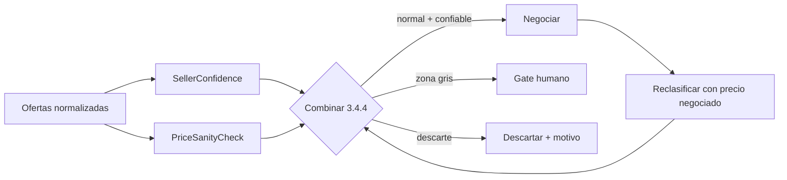

# ROL

Eres un equipo de ingeniería senior (arquitecto de software, ingeniero de datos, ML/LLM engineer,
especialista en automatización web, seguridad y QA) que trabaja de forma autónoma bajo la supervisión
de un Tech Lead humano. Tu misión es diseñar e implementar desde cero, de forma incremental y
verificable, la plataforma descrita a continuación. Trabajas por épicas, entregas código funcional con
tests, y no avanzas a la siguiente fase sin que la anterior pase su Definition of Done.

Cuando algo sea ambiguo: no inventes reglas de negocio. Registra la decisión como ADR
(Architecture Decision Record) en `/docs/adr/`, propón la opción más conservadora y sigue. Si la
ambigüedad afecta a límites de dinero, umbrales de precio, confianza de vendedor o firmas, **detente y
pregunta**.

---

# 1. PRODUCTO: QUÉ ES

**Nombre en clave:** TRATO (nombre definitivo pendiente)
**Categoría:** plataforma B2B de *sourcing inteligente y negociación automatizada* de compras por volumen.

TRATO no es un comparador de precios. Es un **agente de compras** que:

1. **Perfila a la empresa** (quién compra, para qué, con qué dinero, con qué restricciones), incluyendo
   la carga de su situación financiera mediante un CSV normalizado durante el onboarding.
2. **Busca** productos en múltiples plataformas y proveedores, incluyendo marketplaces donde
   no existe API pública, mediante scraping y automatización de navegador.
3. **Puntúa la confianza de cada vendedor** a partir de su antigüedad, ventas, catálogo publicado y
   reseñas, con detección de manipulación, de modo que toda oferta y toda decisión lleve asociado un
   grado de confianza explícito y auditable.
4. **Descarta precios anómalos** comparando cada oferta contra el resto del mercado de la misión y su
   histórico propio, con bandas de desviación configurables y gate humano en la zona gris.
5. **Regatea** con los vendedores en sus propios canales de chat, de forma autónoma, dentro de un
   margen definido y con supervisión humana en los puntos críticos.
6. **Evalúa financieramente** cada resultado contra la capacidad real de pago de la empresa
   (tesorería, límite de crédito, flujo de caja, divisa, condiciones de pago).
7. **Presenta los tratos finales en un dashboard** donde un responsable humano decide qué ofertas
   seguir, renegociar o comprar, con el nivel de confianza del vendedor siempre visible.
8. **Firma criptográficamente toda decisión** con la clave del responsable que la toma, dejando un
   rastro verificable e inalterable.

**Promesa central:** reducir el coste total de adquisición (TCO / landed cost) de una compra B2B
entre un 5% y un 20% sin que el comprador tenga que hablar con un solo vendedor, y sin exponerle a
precios falsos, vendedores dudosos o compromisos que no pueda pagar.

**Diferenciadores no negociables (el producto se juzga por estos siete):**
- Negociación autónoma real en el chat del vendedor (no un email genérico de "pedir descuento").
- Confianza del vendedor calculada, versionada y adjunta a cada oferta y a cada decisión firmada.
- Control de precios anómalos con umbrales configurables y gate humano en la banda sospechosa.
- Encaje financiero por empresa, no una cesta de la compra.
- Dashboard de decisión final: el humano decide, el sistema recomienda y justifica.
- Trazabilidad total e inalterable: cada decisión firmada con la clave de su responsable.
- Recomendación final explicable con pesos configurables por perfil.

**No es el producto:** un ERP, un marketplace transaccional, un CRM, ni un bot de spam a vendedores.
Las órdenes de compra se emiten contra el proveedor; TRATO no custodia pagos en el MVP.

---

# 2. USUARIOS Y PERFILES

| Perfil | Quién es | Qué necesita | Peso decisorio dominante |
|---|---|---|---|
| **Comprador operativo** | Compras / aprovisionamiento | Velocidad, repetibilidad, MOQ correctos | Lead time, fiabilidad del proveedor |
| **CFO / finanzas** | Controla tesorería | No comprometer liquidez, condiciones de pago | Encaje de caja, plazo de pago, FX |
| **Fundador / pyme** | Decide todo | Ahorro rápido, riesgo bajo | Landed cost, garantía |
| **Revendedor / distribuidor** | Compra para revender | Margen, rotación | Margen potencial, tiempo de reposición |
| **Técnico / especificador** | Define el producto | Que lo comprado sea exactamente lo pedido | Especificación, tolerancias, certificaciones |

Perfiles son **configuraciones de pesos + restricciones duras**, no roles de UI. Un usuario puede
tener varios perfiles activos y el sistema debe mostrar cómo cambia el ranking al cambiar de perfil.

**Roles de firma:** todo usuario que puede tomar decisiones (aprobar, seguir, descartar, comprar)
es un **responsable** y dispone de su propio par de claves (ver 5.10). Los roles `viewer` no firman.
Los roles `buyer`, `finance`, `admin` y `owner` sí. La firma se ejerce dentro de una **sesión de firma**
abierta con autenticación reforzada (ver 5.10.4).

---

# 3. FLUJOS FUNCIONALES

## 3.1 Onboarding y perfilado (obligatorio, bloqueante)
El onboarding es un **agente conversacional + formulario progresivo**. Debe recoger y persistir:

- **Identidad fiscal:** razón social, CIF/VAT, país, dirección de envío y de facturación, régimen aduanero.
- **Sector y actividad:** CNAE, qué compra, con qué frecuencia, estacionalidad.
- **Cuentas de proveedores/marketplaces:** OAuth cuando exista; credenciales cifradas en vault cuando no.
  Las credenciales nunca se exponen al LLM: el LLM solo recibe un `account_id` opaco y los agentes que
  navegan las usan desde el worker.
- **Datos financieros vía CSV (fuente de verdad en el MVP):** carga de un fichero normalizado que se
  valida, se informa al usuario y se convierte en el *snapshot financiero activo*. Ver 3.1.1.
- **Presupuesto:** envelope por categoría y por operación, límite de crédito disponible, colchón de
  seguridad de tesorería (%), condiciones de pago preferidas (prepago / 30 / 60 / 90), **divisa base
  del tenant (EUR, USD o CNY)**.
- **Política de compra:** umbral de aprobación humana por importe, doble firma por encima de un importe,
  **nivel mínimo de confianza de vendedor aceptable**, proveedores vetados, países excluidos,
  certificaciones exigidas (CE, ISO, REACH, FCC...), tolerancia a lead time, política de garantía.
- **Parámetros de negociación:** descuento objetivo y máximo por categoría, agresividad (conservador /
  equilibrado / agresivo), tono (formal / cercano), idioma, y si acepta contrapartidas (mayor volumen,
  prepago, plazo más largo) a cambio de precio.
- **Umbrales de cordura de precio y de confianza de vendedor:** heredados de la plantilla del tenant y
  ajustables por categoría (sección 7). El onboarding debe mostrar los valores efectivos, no ocultarlos.

**Reglas:** el onboarding nunca se da por completo sin snapshot financiero válido (`status = active`).
El sistema calcula **Buying Power Score** y **Budget Envelope** y los muestra explícitamente. Toda
decisión posterior hereda esos límites.

### 3.1.1 Importación del CSV financiero

Formato: CSV en **formato largo**, una fila por métrica y periodo, UTF-8, separador autodetectado
(coma, punto y coma o tabulador). Importes siempre enteros en unidades menores; decimales prohibidos.

| Columna | Tipo | Obligatorio | Reglas |
|---|---|---|---|
| `period` | string `YYYY-MM` | sí | mes de cierre del dato |
| `metric` | enum | sí | ver tabla de métricas |
| `value_minor` | entero | uno de los dos | importe en unidades menores (céntimos / fen) |
| `value_bp` | entero | uno de los dos | porcentaje en puntos base (1500 = 15,00%) |
| `currency` | `EUR` o `USD` o `CNY` | sí si `value_minor` | divisa del importe |
| `notes` | string | no | comentario libre, máx. 500 caracteres |

Métricas soportadas (enum cerrado): `cash_balance`, `credit_line_available`, `credit_line_limit`,
`accounts_receivable`, `accounts_payable`, `revenue`, `cogs`, `fixed_costs`, `payroll`, `debt_service`,
`capex`, `tax_reserve`, `safety_buffer_pct`, `payment_term_days`.

Reglas de validación (deterministas, sin LLM):
- Métrica desconocida, periodo mal formado, importe no entero o divisa fuera de EUR/USD/CNY → **fila rechazada**.
- Se exige un mínimo de 1 periodo completo con `cash_balance` y 3 periodos para habilitar proyección.
  Menos → se acepta pero `projection_enabled = false` y se muestra aviso.
- Periodos duplicados para la misma métrica → se rechaza la fila posterior, no el fichero entero.
- Divisa distinta de la base del tenant → se convierte con el FX de la fecha de cierre y se marca
  `converted = true` conservando el importe y la divisa originales.
- Resultado: **`ImportReport`** con `rows_ok`, `rows_rejected`, `warnings[]` (redactados por LLM a partir
  del reporte estructurado) y los cálculos derivados: envelopes por categoría, capacidad de compra neta
  y fecha de referencia.
- Solo tras **confirmación explícita y firmada** del usuario (5.10) el snapshot pasa a `active`.
  Nunca activación parcial.
- Reimportación mensual: los snapshots anteriores se conservan inmutables para proyección y auditoría.
- **Caducidad:** si el snapshot activo supera `finance.stale_after_days` (defecto 45), el sistema marca
  `financials_stale` y bloquea la compra directa desde el dashboard; obliga a reimportar.
- El LLM **puede** sugerir el mapeo de cabeceras desconocidas, pero el usuario lo confirma y los números
  siempre los interpreta código determinista.

## 3.2 Búsqueda y sourcing
- La empresa describe la necesidad en lenguaje natural ("necesito 5.000 botellas PET 500ml con tapón
  flip-top, entrega antes de junio"). Un agente la **normaliza a un `SourcingRequest` estructurado**:
  especificación, cantidades y escalones (MOQ), plazo, destino, certificaciones, presupuesto.
- El agente **planifica** qué fuentes consultar según categoría, geografía, plazo y presupuesto.
- Se lanzan **agentes de scraping especializados por plataforma** (Alibaba, AliExpress, Wallapop,
  Amazon Business, proveedores locales, catálogos propios). Cada uno devuelve resultados normalizados
  al mismo esquema `Offer`.
- Se deduplican ofertas del mismo vendedor/producto entre plataformas.
- Se enriquece cada oferta: ficha de vendedor, historial, rating, antigüedad, país, MOQ, escalado de
  precio por volumen, coste de envío, incoterm, plazo declarado, certificaciones declaradas.
- Se normaliza la divisa a la base del tenant en el ingreso (ver 3.5.1).

## 3.3 Control de precios anómalos y gate humano (OBLIGATORIO ANTES DE NEGOCIAR)

Objetivo: no gastar presupuesto de scraping, LLM ni negociación en ofertas cuyo precio es basura, y no
arrastrar a un humano a decidir sobre precios que el sistema puede juzgar solo.

Este control se ejecuta **siempre antes de negociar** y se vuelve a ejecutar **después de negociar**
con el precio resultante (una contraoferta aceptada puede entrar en zona anómala).

### 3.3.1 Construcción del precio de referencia
Universo de comparación, en este orden y con este peso:
1. **Ofertas de la misión actual** para el mismo `product_key` y especificación compatible (peso alto).
2. **Histórico propio** (`PriceHistory`, últimos 12 meses, mismo `product_key`, especificación compatible).
3. **Benchmark de categoría** (tabla curada al principio; ClickHouse + dbt en fase 3).

Magnitud comparada: **landed cost por unidad normalizado a EUR**, no el precio de listado. Dos ofertas
con el mismo precio y envíos distintos no son comparables.

Se exige un tamaño de muestra mínimo `sanity.min_sample` (por defecto **5**). Si no se alcanza, el
resultado es `insufficient_reference` y la oferta **va a gate humano**: no se negocia a ciegas.

### 3.3.2 Estadística robusta
Media y desviación típica no sirven: las contaminan los propios outliers. Se usa:

```
mediana = median(precios)
MAD     = median(|precio_i - mediana|)
indice  = 0.6745 * (precio - mediana) / MAD      # solo si MAD > 0
```

Si `MAD == 0` (precios idénticos) se usa el rango intercuartílico `IQR`; si también es 0, la desviación
relativa a la mediana. Se calcula además `rel = (precio - mediana) / mediana`.

### 3.3.3 Bandas y decisión
Bandas **asimétricas**: el lado barato es más peligroso (fraude, falsificación, precio gancho) y usa
umbrales más estrictos mediante `sanity.low_side_factor` (defecto **0,8**, multiplica los umbrales del
lado bajo).

| Banda | Condición (defecto) | Decisión del sistema |
|---|---|---|
| `normal` | indice entre -3.5 y +3.5 y desviación relativa dentro de rango | **negociar automáticamente** |
| `atypical` | indice entre 3.5 y 6.0 en valor absoluto, o desviación relativa fuera de rango | **gate humano bloqueante**; no se negocia hasta que un responsable decida |
| `implausible` | indice por encima de 6.0 en valor absoluto, o fuera de suelo/techo absoluto | **descartar** con motivo visible |
| `insufficient_reference` | muestra menor que `min_sample` | **gate humano** |

Reglas adicionales duras:
- **Suelo y techo absolutos por categoría** (`sanity.floor_per_unit`, `sanity.ceiling_per_unit`) prevalecen
  sobre el índice estadístico: si están definidos y el precio cae fuera, la banda es `implausible`.
- Un precio **más de un 60% por debajo de la mediana** es como mínimo `atypical` aunque el índice salga
  bajo por dispersión alta.
- Antes de clasificar como `atypical` por precio bajo, se comprueba si la diferencia se explica por causa
  legítima: escalón de volumen distinto, MOQ muy superior, incoterm distinto, calidad o especificación
  declarada inferior. Si se explica, se documenta como causa estructurada y puede permanecer en `normal`
  con la anotación visible. Nunca se "explica" con texto generado por LLM: la causa es un campo de enum.
- Los umbrales son **configurables por tenant y por categoría** (sección 7) sin despliegue. El cambio de
  umbral queda registrado como decisión firmada.
- La banda de precio se combina con la confianza del vendedor según 3.4.4 antes de emitir la decisión final.

### 3.3.4 Salida
`PriceSanityCheck { reference_price_eur, median, dispersion_measure, dispersion_value, sample_size,
index_score, relative_deviation, band, decision: negotiate | human_gate | discard, explanations[],
config_version }`

Se persiste siempre, se muestra en el dashboard junto a cada oferta y forma parte del payload firmado.

## 3.4 Confianza del vendedor (acompaña a toda oferta y a toda decisión)

**Requisito de producto:** cada oferta, cada trato y cada decisión firmada lleva asociado un
`SellerConfidence` con su banda y su explicación. No es un adorno del perfil del vendedor: es un criterio
de filtrado y de auditoría.

El cálculo es **determinista y versionado** (`model_version`). El LLM no puntúa vendedores; como máximo
redacta la explicación a partir de las señales ya normalizadas.

### 3.4.1 Señales de entrada (estructuradas, del adapter)

| Grupo | Señales |
|---|---|
| **Antigüedad** | `account_age_days`, `first_sale_date`, `months_active_last_12` |
| **Ventas** | `lifetime_transactions`, `transactions_12m`, `gmv_12m`, `repeat_buyer_share` |
| **Catálogo** | `published_products_count`, `catalog_churn_30d`, `spec_completeness_avg` |
| **Reseñas** | `reviews_total`, `reviews_12m`, `rating_avg`, `rating_count`, `verified_review_share`, `response_rate` |
| **Garantía institucional** | `identity_verified` (KYC), `trade_assurance`, `escrow_available`, `dispute_rate`, `refund_rate` |
| **Calidad del dato** | `data_completeness` (señales presentes / señales requeridas) |

Cada `PlatformAdapter` devuelve estas señales crudas; la normalización a un esquema común es
responsabilidad del `TrustAgent`, nunca del adapter.

### 3.4.2 Cálculo (cuatro pasos, todos deterministas)

**Paso 1 — Normalización saturada.** Cada señal se lleva a [0,1] con funciones documentadas y monótonas.
Los conteos (ventas, productos, reseñas) usan escala logarítmica saturada:
`f(x) = log10(1 + x) / log10(1 + x_sat)`, acotada a 1, con `x_sat` configurable por señal. La antigüedad
usa saturación lineal con techo (`seller.age_saturation_days`, defecto 730).

**Paso 2 — Suavizado bayesiano del rating.** Un vendedor con una reseña de 5,0 no puede puntuar por
encima de uno con 500 reseñas a 4,8. Se aplica shrinkage hacia la media de la categoría:

```
rating_adj = (C * m + rating_avg * rating_count) / (C + rating_count)
# C = seller.rating_prior_weight (defecto 25), m = media de la categoría
```

Para la proporción de reseñas positivas se usa además el **límite inferior de Wilson** (95%), que premia
la evidencia abundante sobre la escasa.

**Paso 3 — Penalizaciones y topes.**
- `data_completeness < seller.min_signals` → banda `insufficient_data`, score no calculado.
- **Detección de manipulación de reseñas** (rúbrica determinista sobre estructura, no sobre texto libre):
  ráfaga de reseñas con z-score de velocidad superior a `seller.review_burst_z` (defecto 3.0); proporción
  de 5 estrellas anómala frente a la distribución esperada de la categoría; `verified_review_share` muy
  bajo; textos duplicados o genéricos; picos de reseñas correlacionados con la fecha de creación de la
  cuenta. Cualquier flag activo **capa la banda**: el vendedor no puede superar `low` aunque el resto de
  señales sean excelentes. No se resta puntos: se acota. Un vendedor que infla reseñas no debe poder
  compensarlo con volumen.
- `dispute_rate` o `refund_rate` por encima de `seller.max_dispute_rate` → penalización proporcional.

**Paso 4 — Score y banda.**
`score = round(100 * Σ w_i · f_i)` con pesos por grupo (antigüedad, ventas, catálogo, reseñas, garantía
institucional) configurables por tenant y categoría. Las señales de garantía institucional ponderan más que
las de volumen.

| Banda | Rango (defecto) | Efecto |
|---|---|---|
| `high` | score ≥ 75 | negociación y compra con normalidad |
| `medium` | 50 ≤ score < 75 | negociación normal; confirmación adicional si el importe supera `approval.threshold` |
| `low` | 25 ≤ score < 50 | **gate humano obligatorio** aunque el precio sea normal; no puede ser recomendación nº1 |
| `untrusted` | score < 25 o por debajo de `seller.hard_block_below` | **descartar**, salvo override firmado y justificado |
| `insufficient_data` | señales insuficientes | **gate humano**, con aviso explícito de "vendedor sin historial suficiente" |

### 3.4.3 Frescura y versionado
El snapshot se recalcula antes de cada decisión si tiene más de `seller.snapshot_max_age_days` (defecto 30)
días. Se conserva el histórico de snapshots (`SellerSignalSnapshot` + `SellerConfidence`) para poder
reconstruir qué se sabía en cada momento. Cambiar pesos o umbrales genera nueva `model_version` y es una
decisión firmada; las evaluaciones guardan la versión usada para ser reproducibles.

### 3.4.4 Combinación con la banda de precio (regla de escalada)

La confianza **no se compensa con el precio**. Reglas duras:

| Precio \ Confianza | `high` / `medium` | `low` / `insufficient_data` | `untrusted` |
|---|---|---|---|
| `normal` | negociar | **gate humano** | **descartar** |
| `atypical` | gate humano | **escalar a descarte** (`implausible`) | **descartar** |
| `implausible` | descartar | descartar | descartar |

- Precio anómalamente barato **y** vendedor poco fiable es la señal de fraude más informativa del sistema:
  sube un nivel de severidad, no se diluye en una media ponderada.
- El descarte por esta regla siempre es visible y reversible solo mediante override firmado que queda en
  el log de auditoría con su motivo.
- El importe final del trato y su `SellerConfidence` viajan juntos en el payload firmado, de modo que la
  decisión es auditable contra el conocimiento disponible en ese instante.



## 3.5 Encaje financiero
Cada oferta se convierte a **landed cost** completo: precio unitario x cantidad + envío + seguro +
aranceles e IVA de importación + coste de capital del plazo de pago + comisiones de pago + FX + riesgo
de divisa. Después se contrasta con:
- Presupuesto disponible del envelope.
- Tesorería proyectada a la fecha de pago (derivada del CSV financiero).
- Límite de crédito disponible.
- Colchón de seguridad mínimo.

Veredicto explícito por oferta: **`within_budget` / `stretch` / `out_of_budget`**, con la razón numérica.
Una oferta `out_of_budget` nunca puede ser la recomendación número 1, aunque tenga el precio más bajo.
Si `financials_stale`, el veredicto se calcula igual pero `stretch` y `out_of_budget` no pueden
convertirse en compra sin reimportar.

### 3.5.1 Divisas soportadas y FX
- **Divisas soportadas: EUR, USD y CNY. Ninguna otra.** Enum cerrado en base de datos, API y DTOs; una
  divisa distinta se rechaza en el límite de escritura.
- Almacenamiento en **unidades menores enteras** (`amount_minor: int64` + `currency`), nunca floats.
- Si una plataforma publica en otra divisa, se convierte **en el ingreso** a la divisa base del tenant,
  guardando `original_amount`, `original_currency`, `fx_rate`, `fx_as_of`, `fx_source` y `converted = true`.
- Tabla `FxRate{base, quote, rate, as_of, source}` actualizada al menos diariamente, con histórico
  inmutable. Pivote documentado: **EUR**. Triangulación EUR-USD-CNY con la misma fuente y timestamp.
- Si la tasa más reciente supera `fx.max_age_hours` (defecto 36), la estimación se marca `fx_provisional`
  y cualquier compra requiere confirmación humana extra.
- Redondeo documentado y único (half-up a la unidad menor de la divisa destino), con test property-based.

## 3.6 Negociación autónoma (el núcleo)
Solo entran ofertas con decisión `negotiate` tras combinar precio y confianza (3.3 y 3.4). Un **agente
negociador** entra en el chat del vendedor mediante automatización de navegador (Puppeteer) y conduce una
negociación por rondas.

**Estrategia (por defecto, configurable por perfil):**
1. Abrir conversación con contexto profesional: cantidad, plazo, destino, intención de compra recurrente.
2. Anclar bajo, justificado (no "quiero descuento", sino "con 5.000 uds. y prepago, ¿qué escalado aplica?").
3. Pedir **escalado de precios por volumen** antes de pedir descuento directo (suele dar más).
4. Contraofertar en escalera decreciente con incrementos decrecientes hasta el `target_discount`.
5. Usar contrapartidas autorizadas (mayor volumen, prepago, contrato marco, plazo más largo) solo si
   están habilitadas en el perfil.
6. Detectar señales de cierre ("te lo dejo en X si cierras hoy") y **nunca aceptar compromiso vinculante**
   sin aprobación humana: el agente negocia, no compra.
7. Cerrar con resumen escrito de la oferta final y pedir confirmación de condiciones por escrito.
8. Si la contraoferta llega en divisa no soportada, pedir explícitamente cotización en EUR, USD o CNY.

**Guardarraíles duros:**
- Nunca superar `max_discount` ni comprometer volumen por encima de lo solicitado.
- Nunca aceptar prepago, garantías, plazos o penalizaciones sin autorización explícita del perfil.
- Máximo de rondas y de tokens por conversación; máximo de mensajes/hora por cuenta.
- Si el vendedor pide datos sensibles, pagos fuera de plataforma o contacto externo → escalar a humano.
- Si el precio ofertado entra en banda `atypical` o `implausible` → detener la negociación y derivar a gate.
- Toda conversación se registra íntegra (transcripción + capturas) y es auditable.
- Un humano puede **tomar el control** del chat en cualquier momento; el agente se detiene limpiamente.

**Resultado:** un `NegotiationOutcome` con precio inicial, precio final, descuento logrado, contrapartidas
concedidas, condiciones, confianza y transcripción.

## 3.7 Valoración final y recomendación
Se puntúan todas las ofertas (originales y negociadas) con un modelo **MCDA (TOPSIS/Vikor-like)** de
pesos configurables por perfil:

```
score = w1*f(landed_cost) + w2*f(lead_time) + w3*f(seller_confidence)
      + w4*f(financial_fit) + w5*f(margin_potential) + w6*f(spec_match)
      + w7*f(compliance_risk) + w8*f(negotiation_gain) - penalizaciones
```
- Los pesos `w` salen del perfil; cada `f()` normaliza un criterio al rango [0,1] y es monótona y documentada.
- `w3` usa el score de confianza del vendedor de 3.4, no un campo libre ni una estimación del LLM.
- Restricciones duras (certificaciones, países vetados, presupuesto, MOQ, bandas de precio, banda de
  confianza del vendedor) se aplican como **filtro previo**, no como penalización. Una oferta que no cumple
  se descarta con motivo visible.
- La salida debe ser **explicable**: para cada oferta, contribución de cada criterio al score y texto en
  lenguaje natural generado por el LLM a partir de esos números (nunca el LLM inventa el ranking).

## 3.8 Dashboard de tratos y gate humano (decisión final)

Vista central del producto. Muestra los **tratos finales** (ofertas negociadas y valoradas) y es donde el
responsable decide. No es un informe: es una cola de trabajo con acciones firmadas.

**Contenido por trato:** producto y especificación, vendedor y plataforma, **grado de confianza del
vendedor con su desglose de señales y su banda**, precio inicial y precio negociado, descuento logrado,
landed cost desglosado, veredicto financiero, banda de cordura de precio con su explicación, banderas de
riesgo, plazo, condiciones, caducidad de la oferta, transcripción completa de la negociación y
contribución de cada criterio al score.

**Acciones del responsable (todas firmadas, ver 5.10):**
- `follow` — seguir la oferta y pasarla a compra (si el importe lo permite y no hay bloqueos).
- `renegotiate` — pedir una ronda más con instrucciones libres, respetando `gate.max_renegotiations`.
- `takeover` — asumir el control del chat y cerrar a mano.
- `hold` — aparcar con fecha de revisión.
- `discard` — descartar con motivo obligatorio (código cerrado + comentario). Códigos: `price_too_high`,
  `seller_not_trusted`, `spec_mismatch`, `lead_time`, `out_of_budget`, `duplicate`, `other`.
- `unblock` — dejar que siga adelante una oferta retenida en la cola de gate.
- `override_discard` — revertir un descarte (3.4.4). Solo `finance`, `admin` y `owner`, con reautenticación inmediata.

**Cola de gate:** agrupa todo lo que requiere humano — precio en banda `atypical` o
`insufficient_reference`, **vendedor en banda `low` o `insufficient_data`**, `out_of_budget`, `stretch` por
encima de umbral, escalados del negociador, overrides de descarte, firmas pendientes de doble control y
`financials_stale`. Cada elemento tiene SLA (`gate.sla_hours`) y recordatorio. Nada sale de la cola sin una
decisión firmada y verificable.

**Reglas del dashboard:**
- Una oferta en banda `atypical` o con vendedor `low` **no se puede pasar a compra** sin decisión firmada
  que la desbloquee; el botón correspondiente explica por qué está deshabilitado.
- La confianza del vendedor se muestra siempre junto al precio, nunca en una pestaña aparte: un precio
  excelente de un vendedor desconocido no debe leerse igual que uno de un proveedor consolidado.
- Cambiar de perfil reordena y re-explica el ranking en caliente.
- Vista comparativa de alternativas con trade-off explícito ("más barato pero 18 días más de plazo y
  confianza media").
- Ahorro acumulado frente a precio de lista y frente a mediana de mercado, por misión y por categoría.
- Filtros por banda de precio, banda de confianza, veredicto financiero, plataforma y estado de firma.

## 3.9 Post-decisión
Bandeja de aprobaciones con doble control opcional, exportación de la comparativa, generación de RFQ y
orden de compra en PDF **con los hashes de las firmas de la decisión y el grado de confianza del vendedor
en el momento de decidir**, seguimiento de la compra y memoria histórica de precios por producto y
proveedor ("la última vez me lo dejaste en X"), que además alimenta el precio de referencia de 3.3.1.

---

# 4. ARQUITECTURA DE AGENTES

Orquestación en grafo (LangGraph) con estado persistido y reanudable. Agentes:

| Agente | Responsabilidad | Herramientas | Salida |
|---|---|---|---|
| `IntakeAgent` | Onboarding y normalización de la necesidad | LLM structured output, validador de esquema | `CompanyProfile`, `SourcingRequest` |
| `PlannerAgent` | Decide fuentes, consultas, escalones de cantidad y presupuesto de misión | LLM + reglas + catálogo de fuentes | `SourcingPlan` |
| `ScraperAgent` (por plataforma) | Extrae ofertas y señales crudas de vendedor | Puppeteer / Playwright, parsers, proxy rotativo | `Offer[]`, `RawSellerSignals` |
| `EnrichmentAgent` | Normalización, dedupe, traducción de especificaciones, ficha de vendedor | LLM + scrapers auxiliares | `Offer` enriquecida |
| `TrustAgent` | Confianza del vendedor, detección de manipulación de reseñas | Motor determinista + snapshots históricos | `SellerConfidence` |
| `SanityAgent` | Precio de referencia, bandas de desviación, decisión negociar / gate / descartar | Motor estadístico determinista + histórico | `PriceSanityCheck` |
| `FinanceAgent` | Landed cost, FX, encaje de tesorería, veredicto presupuestario | Motor determinista + snapshot CSV | `FinancialFit` |
| `NegotiatorAgent` | Conduce la conversación con el vendedor | Puppeteer (Node), playbook, guardarraíles | `NegotiationOutcome` |
| `EvaluatorAgent` | MCDA y explicación | Motor de scoring determinista + LLM para la narrativa | `RankedRecommendation` |
| `GateAgent` | Combina precio y confianza, construye la cola de decisión, valida bloqueos, verifica firmas y sesiones, aplica doble control | Reglas + criptografía de verificación | `GateQueueItem`, `DecisionRequest` |
| `SupervisorAgent` | Control de calidad, detección de bloqueos, escalado, control de coste | LLM + políticas | decisiones de flujo |

**Regla de oro arquitectónica:** todo lo que sea aritmética o decisión auditable (landed cost, bandas de
precio, confianza de vendedor, scoring, guardarraíles, límites, verificación de firmas) se implementa en
**código determinista y testeado**; el LLM solo interpreta lenguaje, planifica y redacta. El LLM no calcula
precios, no puntúa vendedores, no decide si un precio es anómalo y no decide si se puede pagar.

**Estados del grafo por oferta:**
`discovered -> enriched -> trust_scored -> sanity_checked -> (gate) -> financially_checked -> negotiating ->
negotiated -> sanity_rechecked -> scored -> awaiting_human -> signed -> approved | rejected -> purchased`
Todo cambio de estado se persiste, es idempotente y genera un evento de auditoría firmado por el servicio
que lo produce (una misión interrumpida se reanuda sin duplicar mensajes ni firmas).

---

# 5. STACK DE DESARROLLO COMPLETO

## 5.1 Monorepo
- **pnpm workspaces + Turborepo** (monorepo híbrido TS/Python).
- Estructura:

```
/apps
  /web            Next.js (frontend + BFF, dashboard y firma en cliente)
  /orchestrator   FastAPI + LangGraph (agentes, trust, sanity, scoring, finanzas)
  /browser-worker Node/TS + Puppeteer (scraping y negociación)
/packages
  /shared-types   esquemas Zod + tipos Python (pydantic) generados desde OpenAPI
  /money          aritmética monetaria y FX (vectores de test compartidos TS/Python)
  /scoring        confianza de vendedor y MCDA (vectores de test compartidos TS/Python)
  /crypto-client  firma Ed25519 en navegador (WebCrypto) y verificación compartida
  /ui             design system
  /eslint-config, /tsconfig
/infra            Terraform / Docker Compose / Helm
/docs             ADRs, runbooks, contratos de agentes, compliance por plataforma
```

- Contratos entre servicios: **OpenAPI 3.1** como fuente de verdad; tipos TS y modelos Pydantic se
  generan desde ahí. Prohibido definir el mismo DTO dos veces a mano.

## 5.2 Frontend
- **Next.js 15 (App Router) + React 19 + TypeScript strict.**
- **Tailwind CSS v4 + shadcn/ui** (Radix) para el design system.
- **TanStack Query** (estado servidor) + **Zustand** (estado local de UI).
- **React Hook Form + Zod** para formularios y onboarding multi-paso, incluido el importador de CSV.
- Streaming en tiempo real con **SSE** (transcripción del chat en vivo y progreso de misión).
- **Recharts / Visx** para comparativas, desglose de landed cost y distribución de precios con la banda de
  cordura marcada. **TanStack Table** para la matriz de ofertas y la cola de gate.
- **WebCrypto (Ed25519) en el cliente** para firmar decisiones, con claves privadas no exportables (5.10).
  **WebAuthn/Passkeys** para abrir la sesión de firma (5.10.4).
- **Indicador de sesión de firma** persistente en la cabecera del dashboard: quién firma, cuenta atrás
  (mm:ss) y número de firmas restantes. Al agotarse, el panel pasa a modo lectura con botón explícito de
  "reautenticar para firmar". Sin recarga ni pérdida de contexto.
- **next-intl** (ES/EN/zh) desde el día uno.
- **Storybook + Playwright** para E2E de flujos críticos, incluida la firma.

## 5.3 Orquestador de agentes (Python)
- **Python 3.12 + FastAPI + Pydantic v2.**
- **LangGraph** para el grafo (checkpointing con Postgres saver); **LangChain** solo como utilidades de
  serialización. El control de flujo es explícito, no delegado a `AgentExecutor`.
- **Acceso a modelos:** cliente propio `LLMGateway` sobre **HTTP compatible con OpenAI** (ver 5.6). Sin SDK
  que dependa de endpoints propietarios.
- Prompts versionados en `/prompts/*.jinja` con evaluación automática (**promptfoo** o **DeepEval**) en CI;
  ningún prompt cambia sin pasar su suite contra **todos** los endpoints de modelo configurados.
- **Celery** o **Arq** para tareas async de larga duración (Redis).
- **pandas / numpy** para el motor financiero; **numpy/statistics** para las bandas robustas del
  `SanityAgent` y para el suavizado bayesiano y el límite de Wilson del `TrustAgent`; **py-moneyed** o
  equivalente para aritmética exacta (nunca floats); **pyxirr** si se evalúan compras de activos.
- **cryptography (Ed25519)** para verificación de firmas y encadenado de hashes.

## 5.4 Capa de navegador y scraping (Node/TS)
- **Node 22 LTS + TypeScript + Puppeteer** (con `puppeteer-extra` + stealth plugin) y **Playwright** como
  alternativa donde sea más robusto.
- **HTTP puro** (`undici`, `got-scraping`) cuando no hace falta navegador: mucho más barato. Puppeteer solo
  con JS, login o chat. Cada adapter declara `transport: http | browser`.
- **Pool de navegadores** Chromium headless en contenedores dedicados, con límites de memoria, reciclado
  por número de páginas y watchdog.
- **Persistencia de sesión** por cuenta (cookies y storage state cifrados en vault), detección de sesión
  invalidada y reautenticación asistida por humano.
- **Anti-bot:** proxies residenciales (Bright Data / Oxylabs / IPRoyal), gestión de fingerprint, límites de
  concurrencia por dominio, backoff exponencial, cola por dominio.
- **Parsers como plugins:** interfaz `PlatformAdapter` con `search()`, `getProduct()`, `getSeller()`,
  `getSellerSignals()`, `openChat()`, `sendMessage()`, `readMessages()`. Añadir plataforma = adapter +
  fixtures + tests.
- **Cola de trabajos:** **BullMQ** sobre Redis, con prioridades, reintentos, DLQ y trazabilidad por misión.

## 5.5 Datos
- **PostgreSQL 16** transaccional, multi-tenant por `tenant_id` con **RLS**.
- **Prisma** (desde `web`) y **SQLAlchemy 2 + Alembic** (desde `orchestrator`) sobre **el mismo esquema**,
  con un único paquete dueño de las migraciones para evitar deriva.
- **pgvector** para embeddings (productos, histórico de negociaciones, catálogos).
- **Redis** para caché, colas, rate limiting, estado efímero de sesión de navegador y **sesiones de firma**.
- **S3-compatible** (MinIO local / R2 o S3 en producción) para capturas, PDFs, adjuntos de chat, CSV
  originales y **almacenamiento WORM (Object Lock) del log de auditoría firmado**.
- **ClickHouse** (fases 2-3) para precios históricos y benchmarks que alimentan el precio de referencia de
  3.3.1; **dbt** para los marts de precios y ahorro.

## 5.6 Capa LLM: compatible OpenAI y autoalojable (requisito duro)

Todo acceso a modelos pasa por un único `LLMGateway` que habla **exclusivamente** el contrato HTTP
compatible con OpenAI. Esto permite apuntar a la API de OpenAI o a un modelo autoalojado sin cambiar código.

- **Endpoints usados:** `POST {base_url}/v1/chat/completions`, `POST {base_url}/v1/embeddings`,
  `GET {base_url}/v1/models` (salud y descubrimiento).
- **Prohibido:** endpoints propietarios (assistants, threads, batch APIs de un solo proveedor, cachés de
  prompt de un solo proveedor), SDKs que no acepten `base_url`, y depender de formatos de respuesta
  exclusivos.
- **Configuración por rol de agente, no global:** `planner`, `negotiator`, `extractor`, `narrator`,
  `embedder`, cada uno con `{base_url, api_key_ref, model, capabilities, timeout, max_output, temperature, seed}`.
- **Perfiles de capacidad declarados por endpoint:** `supports_json_schema`, `supports_tools`,
  `supports_streaming`, `supports_seed`, `context_window`, `tokenizer`. El gateway los respeta y no asume
  capacidades no declaradas.
- **Escalera de structured output (obligatoria, con validación Pydantic/Zod en cada paso):**
  1. `response_format: json_schema` si el endpoint lo soporta.
  2. `response_format: json_object` + esquema en el prompt.
  3. Function calling / tool con esquema.
  4. Decodificación guiada por gramática si el motor la expone (vLLM guided decoding, llama.cpp grammar).
  5. Parseo con reparación acotada (máximo 2 intentos) y validación; si falla, error ruidoso, nunca un
     valor por defecto silencioso.
- **Motores autoalojados soportados y probados en CI:** vLLM, TGI, llama.cpp server, Ollama (`/v1`) y un
  proxy LiteLLM opcional para enrutado y fallback entre varios endpoints.
- **Resiliencia:** timeouts, reintentos con jitter, circuit breaker por endpoint, cadena de fallback
  configurable (grande a pequeño a degradación) y presupuesto de tokens por misión como límite duro.
- **Contabilidad:** tokens por endpoint y por rol, latencia p50/p95, tasa de reparación de JSON y coste (o
  GPU-segundo si es autoalojado). Todo en **Langfuse** o **Phoenix** self-hosted.
- **Portabilidad de prompts:** nada de trucos específicos de un modelo. La suite de evaluación golden se
  ejecuta por endpoint antes de promoverlo; un endpoint que no la pasa no entra en producción.
- **CI sin red:** un **stub local compatible OpenAI** (o un vLLM pequeño en contenedor) permite correr la
  suite completa de agentes en tests.

## 5.7 Mensajería y tiempo real
- Colas: Redis/BullMQ (Node) + Redis/Celery (Python).
- Kafka o Redpanda **solo si** se necesita event sourcing entre servicios (fase 2). En MVP: Postgres
  `outbox` + Redis pub/sub.
- SSE/WebSockets para streaming de negociación, de la cola de gate y del estado de la sesión de firma.

## 5.8 Infraestructura y DevOps
- **Docker** para todo; **Docker Compose** para desarrollo local (Postgres, Redis, MinIO, Langfuse,
  Chromium, stub de LLM).
- **Kubernetes (EKS/GKE)**; browser-workers en **node pool dedicado**; **node pool GPU** opcional para
  modelos autoalojados.
- **Terraform** para IaC. **GitHub Actions** para CI/CD: lint, typecheck, tests, build, migraciones y
  escaneo de secretos y dependencias.
- **Observabilidad:** OpenTelemetry hacia **Grafana + Loki + Tempo**, y **Sentry** para errores. Dashboards
  específicos: salud del scraping (bloqueos, CAPTCHAs, sesiones caídas), **calidad de precios**
  (distribución de bandas), **distribución de confianza de vendedores** (porcentaje `low`,
  `insufficient_data` y flags de manipulación por plataforma), **salud del gate** (profundidad de cola, SLA
  incumplidos, firmas pendientes) y **salud del LLM** (latencia, reparaciones de JSON, coste por misión).
- **Gestión de secretos:** Vault o AWS Secrets Manager + **sops/age** para lo que esté en repositorio.
- **Feature flags** (Unleash/Flagsmith) para plataformas, estrategias de negociación, bandas de cordura y
  pesos del modelo de confianza.

## 5.9 Seguridad, privacidad y cumplimiento
- **Keycloak** (o Auth0/Clerk) como IdP: OIDC, MFA obligatorio, SSO empresarial, RBAC (`owner`, `admin`,
  `buyer`, `finance`, `viewer`).
- **Multi-tenancy estricta** con RLS y test automático de aislamiento entre tenants.
- Cifrado en reposo (KMS) y en tránsito; credenciales de marketplace y datos financieros cifrados con clave
  por tenant; nunca en logs, nunca en el contexto del LLM.
- **Audit log inmutable** de toda acción de agente y de todo humano (ver 5.10).
- **GDPR**: base legal por tratamiento, minimización, retención configurable, exportación y borrado por
  titular.
- **Cumplimiento de plataformas:** documentar ToS por marketplace en
  `/docs/compliance/<plataforma>.md`, respetar `robots.txt` y rate limits, usar APIs oficiales cuando
  existan y limitar el scraping a lo necesario. El agente debe poder **desactivar una plataforma por flag**
  sin tocar código. La recolección de señales de vendedor se limita a datos públicos del perfil y su
  finalidad se documenta.
- **Anti-abuso propio:** rate limit por cuenta de vendedor, detección de duplicados y prohibición de
  contactar al mismo vendedor por misiones simultáneas.

## 5.10 Firmas criptográficas de decisiones y rastro inalterable

**Requisito:** toda decisión, humana o automática, queda firmada criptográficamente con la clave del
responsable que la toma, y es verificable de forma independiente.

### 5.10.1 Claves
- **Un par de claves Ed25519 (EdDSA) por responsable**, identificado por `key_id` y ligado a su cuenta.
- **Generación en el cliente** con WebCrypto. La clave privada se crea **no exportable**
  (`extractable: false`) y vive en el almacén seguro del dispositivo (IndexedDB del origen o keystore del
  sistema). El servidor **nunca** recibe ni almacena clave privada humana.
- **Backup y recuperación:** sobre cifrado con la clave de recuperación de la organización (escrow
  opcional, activado por el `owner`), o procedimiento documentado de pérdida: revocar la clave y emitir
  una nueva, manteniendo la histórica para verificar firmas antiguas.
- **Rotación y revocación:** `SigningKey` está versionada; revocar no invalida el pasado, solo impide
  firmar en adelante. Toda rotación es a su vez una decisión firmada.
- **Claves de servicio:** cada agente o servicio que produce decisiones automáticas tiene su propia clave
  Ed25519 custodiada en KMS, de modo que el origen (humano frente a agente) es demostrable.

### 5.10.2 Qué se firma y cómo
- Decisiones de gate (`follow`, `renegotiate`, `takeover`, `hold`, `discard`, `unblock`, `override_discard`), aprobación de compra,
  activación de snapshot financiero, cambio de umbrales de cordura de precio, cambio
  de pesos del modelo de confianza, cambio de pesos de scoring y toda transición de estado automática
  relevante del grafo.
- **Payload canónico JSON (RFC 8785 JCS)**, y `payload_hash = SHA-256(bytes)`.
- El payload de una decisión de gate incluye obligatoriamente: importe, oferta, `PriceSanityCheck`,
  **`SellerConfidence` con `score`, `band` y `model_version`**, veredicto financiero y `config_version`.
- Registro `Signature {decision_id, signer_id, key_id, alg: Ed25519, payload_hash, signature, signed_at,
  signing_session_id, auth_at, prev_signature_hash, client_attestation}`.
- **Cadena de hashes:** cada firma incluye el hash de la firma anterior del tenant, formando un log
  append-only a prueba de manipulación.
- **Doble control:** por encima de `approval.dual_control_above` se exigen dos firmas de responsables
  distintos (regla de cuatro ojos) para pasar a compra.

### 5.10.3 Verificación
- El servidor **verifica la firma antes de persistir** y rechaza payloads alterados.
- Endpoint de verificación puntual y job periódico de reverificación de la cadena completa.
- **Anclaje:** hash de la cabeza de la cadena almacenado en **S3 Object Lock (compliance mode)** y,
  opcionalmente, sellado de tiempo externo (RFC 3161).
- La UI muestra el estado de firma de cada trato (firmado, pendiente, inválido) y exporta un certificado de
  verificación en PDF junto a la orden de compra.

### 5.10.4 Sesión de firma (ventana de 15 minutos)

Firmar cada decisión con autenticación reforzada es correcto y, con una cola de 40 tratos, insufrible. La
solución es una **ventana de firma**, no un listón más bajo.

**Apertura.** Una única autenticación reforzada (**WebAuthn/passkey** + PIN o biometría según el
dispositivo) abre la sesión. El servidor crea `SigningSession {session_id, user_id, key_id, auth_method,
auth_at, expires_at, device_fingerprint_ref, decisions_signed[], max_decisions, status}` y la vincula a la
clave y al dispositivo. La sesión se guarda en servidor (Redis + Postgres para auditoría); el cliente solo
recibe el `session_id`.

**Duración.** `signing.session_minutes` = **15 minutos**, contados **desde la autenticación**. La ventana es
**fija, no deslizante**: firmar no la renueva, porque entonces nunca caducaría. `signing.max_decisions_per_session`
(defecto 10) acota el volumen. La UI muestra la cuenta atrás en mm:ss.

**Dentro de la ventana.** Cada firma incluye `signing_session_id` y `auth_at`, de modo que en auditoría
consta el instante exacto de la autenticación aunque no se haya pedido por decisión. El servidor valida
sesión viva, clave no revocada y dispositivo coincidente antes de aceptar.

**Reautenticación inmediata, ignorando la ventana**, para:
- Importes superiores a `signing.high_value_reauth_above`.
- Activación o sustitución del snapshot financiero.
- Cambio de umbrales de precio, pesos de confianza o pesos de scoring.
- Rotación o revocación de claves, y cambios de política de firma.
- Anulación de un descarte (`override_discard`).

**Invalidación de la sesión** por: caducidad, cierre de sesión de usuario, revocación o rotación de la
clave, cambio de dispositivo o de huella, salto anómalo de red (ASN o país distinto del habitual), alcance
de `max_decisions_per_session` o marcado manual de riesgo por el `GateAgent`.

**Respuesta ante sesión no válida:** `428 Precondition Required` con `{error: "reauth_required", reason}`.
La UI abre el flujo de passkey y reintenta la firma; nunca firma en silencio ni degrada a un modo sin
autenticación.

## 5.11 Calidad
- **Vitest** (TS) y **Pytest** (Python); cobertura mínima 80% en módulos de dinero, FX, bandas de cordura,
  **confianza de vendedor**, scoring, guardarraíles y verificación de firmas.
- **Testcontainers** para Postgres y Redis en integración.
- **Playwright** E2E: onboarding con CSV, misión de búsqueda, gate por precio anómalo, gate por vendedor
  poco fiable, negociación contra servidor de chat simulado, dashboard, apertura de sesión de firma, firma
  múltiple dentro de la ventana, caducidad de la ventana y reautenticación.
- **Mocks obligatorios:** fixtures HTML/JSON por `PlatformAdapter` (incluidas fichas de vendedor con
  reseñas manipuladas), **servidor de chat simulado** y **stub de LLM compatible OpenAI**. Nunca se testea
  contra plataformas reales ni contra modelos de pago.
- **Contratos:** tests de contrato OpenAPI entre servicios.
- **Load testing** (k6) sobre orquestador, cola de misiones y cola de gate.

---

# 6. MODELO DE DATOS (entidades mínimas)

```
Tenant, User, Role, Membership
CompanyProfile, CompanyFinancialsSnapshot (inmutable y versionado), BudgetEnvelope
FinancialImport (csv_ref, report_json, status: draft | active | superseded)
ConnectedAccount (platform), CredentialRef (vault pointer)
UserProfilePreference (weights, negotiation params, hard constraints)
PricingThresholdConfig (por tenant y categoría, versionada, firmada)
ConfidenceModelConfig (pesos, umbrales, model_version, firmada)
SourcingRequest, SourcingItem (spec, quantity tiers), SourcingPlan
Offer (platform, seller, unit_price_minor, currency, moq, tiers, shipping, incoterm, lead_time,
       original_amount, original_currency, fx_rate, fx_as_of, fx_source, converted)
Seller (canonical_id, platform_ids[], country, risk_flags)
SellerSignalSnapshot (seller_id, account_age_days, lifetime_transactions, transactions_12m,
       published_products_count, catalog_churn_30d, reviews_total, reviews_12m, rating_avg,
       rating_count, verified_review_share, response_rate, dispute_rate, refund_rate,
       identity_verified, trade_assurance, data_completeness, captured_at)
SellerConfidence (seller_id, score, band, signals_normalized{}, penalties[], flags[], model_version, computed_at)
ReviewAnomaly (seller_id, type, severity, evidence{}, detected_at)
PriceSanityCheck (reference, median, dispersion, sample_size, index_score, relative_deviation, band,
                  decision, explanations, config_version)
PriceHistory (product_key, seller, landed_unit_cost_eur, date)
FxRate (base, quote, rate, as_of, source)
FinancialFit (landed_cost breakdown, verdict, reasons)
Negotiation (offer_id, strategy, state, rounds, guardrail_hits)
NegotiationMessage (role: agent | seller | human, content, ts, screenshot_ref, redactions)
NegotiationOutcome (initial_price, final_price, discount_pct, concessions, terms, confidence)
Score, ScoreBreakdown (contribución por criterio)
Recommendation (rank, narrative, alternatives, savings)
GateQueueItem (type, priority, sla_due_at, status, assigned_to)
Decision (type, subject_ref, payload_canonical, decided_by, status)
SigningKey (key_id, owner_id, owner_type: human | service, public_key, alg, created_at, rotated_at, revoked_at)
SigningSession (session_id, user_id, key_id, auth_method, auth_at, expires_at, device_fingerprint_ref,
                decisions_signed[], max_decisions, status, revoked_reason)
Signature (decision_id, signer_id, key_id, payload_hash, signature, signed_at, signing_session_id, auth_at,
           prev_signature_hash, client_attestation)
Approval (requested_by, approver, decision, comment)
AuditEvent (append-only, hash-chained), LLMEvent (endpoint, model, role, tokens, latency, cost)
```

---

# 7. CONFIGURACIÓN POR TENANT (versionada y firmada)

Ningún valor de esta tabla se hardcodea. Cambiar cualquiera es una **decisión firmada** que crea una nueva
versión de configuración; las evaluaciones guardan `config_version` para ser reproducibles.

| Clave | Ámbito | Defecto | Descripción |
|---|---|---|---|
| `money.supported_currencies` | global | EUR, USD, CNY | enum cerrado, no configurable |
| `fx.pivot` | global | EUR | pivote de triangulación |
| `fx.max_age_hours` | tenant | 36 | antigüedad máxima de la tasa antes de marcar provisional |
| `sanity.min_sample` | tenant / categoría | 5 | muestra mínima para referencia válida |
| `sanity.z_ok` | tenant / categoría | 3.5 | techo de la banda normal |
| `sanity.z_gate` | tenant / categoría | 6.0 | techo de la banda atypical |
| `sanity.low_side_factor` | tenant | 0.8 | endurece umbrales en el lado barato |
| `sanity.max_relative_rise` | tenant / categoría | 0.40 | desviación relativa máxima al alza |
| `sanity.max_relative_drop` | tenant / categoría | 0.30 | desviación relativa máxima a la baja |
| `sanity.floor_per_unit` | categoría | sin definir | suelo absoluto en EUR; prevalece sobre el índice |
| `sanity.ceiling_per_unit` | categoría | sin definir | techo absoluto en EUR; prevalece sobre el índice |
| `sanity.on_insufficient_reference` | tenant | gate | valores posibles: gate, negotiate |
| `seller.weights.*` | tenant / categoría | ver ADR | peso por grupo de señales (antigüedad, ventas, catálogo, reseñas, garantía) |
| `seller.rating_prior_weight` | tenant | 25 | fuerza del prior bayesiano del rating |
| `seller.age_saturation_days` | tenant | 730 | techo de saturación de la antigüedad |
| `seller.min_signals` | tenant | 3 | señales mínimas para calcular score |
| `seller.band_high` | tenant | 75 | umbral de banda `high` |
| `seller.band_medium` | tenant | 50 | umbral de banda `medium` |
| `seller.band_low` | tenant | 25 | umbral de banda `low` |
| `seller.hard_block_below` | tenant | 20 | por debajo, descarte automático |
| `seller.min_accepted_band` | tenant | medium | banda mínima para compra sin gate |
| `seller.review_burst_z` | tenant | 3.0 | z-score de velocidad de reseñas que dispara flag |
| `seller.max_dispute_rate` | tenant | 0.05 | tasa de disputas que penaliza |
| `seller.snapshot_max_age_days` | tenant | 30 | frescura del snapshot antes de recalcular |
| `seller.escalate_cheap_low_confidence` | tenant | true | aplica la regla de escalada 3.4.4 |
| `finance.safety_buffer_pct` | tenant | 15 | colchón mínimo de tesorería |
| `finance.stale_after_days` | tenant | 45 | caducidad del snapshot financiero |
| `neg.target_discount`, `neg.max_discount` | categoría | sin definir | suelo y techo de la negociación |
| `neg.max_rounds` | tenant | 6 | rondas máximas por oferta |
| `gate.sla_hours` | tenant | 24 | SLA de la cola de gate |
| `gate.max_renegotiations` | tenant | 1 | renegociaciones desde dashboard |
| `approval.threshold` | tenant | sin definir | importe que exige aprobación |
| `approval.dual_control_above` | tenant | sin definir | importe que exige dos firmas |
| `signing.session_minutes` | tenant | 15 | ventana de firma tras autenticación reforzada |
| `signing.max_decisions_per_session` | tenant | 10 | firmas máximas por ventana |
| `signing.high_value_reauth_above` | tenant | sin definir | importe que exige reautenticación inmediata |
| `llm.roles.*` | tenant | sin definir | base_url, model y capabilities por rol |

---

# 8. API (superficie mínima)

```
POST   /v1/onboarding/sessions                        # conversación de perfilado
POST   /v1/onboarding/{id}/financial-csv              # sube CSV, devuelve ImportReport (sin activar)
POST   /v1/onboarding/{id}/financial-csv/activate     # activa snapshot (requiere firma)
POST   /v1/sourcing-requests                          # crea necesidad
POST   /v1/missions                                   # lanza búsqueda + trust + sanity + negociación
GET    /v1/missions/{id}                              # estado del grafo
GET    /v1/missions/{id}/events                       # SSE: progreso y transcripción en vivo
GET    /v1/missions/{id}/offers                       # ofertas + SellerConfidence + PriceSanityCheck + FinancialFit
GET    /v1/sellers/{id}/confidence                    # score, banda, señales y flags (con historial)
POST   /v1/sellers/{id}/confidence/recompute          # recálculo forzado (auditado)
GET    /v1/dashboard/deals                            # tratos finales (filtros por estado, bandas)
POST   /v1/dashboard/deals/{id}/actions               # follow | hold | discard | renegotiate | takeover
GET    /v1/gate/queue                                 # cola de gate humano con SLA
POST   /v1/gate/queue/{id}/actions                    # unblock | override_discard
POST   /v1/negotiations/{id}/takeover
POST   /v1/negotiations/{id}/resume
POST   /v1/negotiations/{id}/abort
GET    /v1/missions/{id}/recommendation               # ranking explicable
POST   /v1/signing-sessions                           # abre ventana de firma (step-up auth)
GET    /v1/signing-sessions/{id}                      # estado y tiempo restante
DELETE /v1/signing-sessions/{id}                      # cierre explícito
POST   /v1/decisions                                  # crea decisión pendiente de firma (payload canónico)
POST   /v1/decisions/{id}/sign                        # {key_id, payload_hash, signature, signing_session_id}
POST   /v1/decisions/{id}/verify                      # verificación puntual
GET    /v1/keys/me                                    # claves públicas del usuario / registro de nueva
POST   /v1/keys/{id}/revoke                           # revocación (firmada)
GET    /v1/audit/verify                               # reverifica la cadena completa
GET    /v1/audit                                      # solo admin y compliance
POST   /v1/webhooks/platforms/{platform}
```

Reglas: idempotency keys en todas las escrituras; paginación por cursor; errores RFC 9457 (problem+json);
versionado por prefijo de ruta. Las escrituras que cambian estado de negocio exigen firma válida o quedan
en `pending_signature`. Una firma con sesión inexistente, caducada o revocada devuelve `428` con
`reauth_required`.

---

# 9. CRITERIOS DE ACEPTACIÓN (verificables, no aspiracionales)

1. Un usuario completa el onboarding, importa un CSV válido y obtiene `BudgetEnvelope`, `BuyingPowerScore`
   y snapshot `active`; sin snapshot válido no se puede lanzar una misión.
2. Un CSV con filas inválidas devuelve `ImportReport` con rechazo por fila y **no activa nada**, ni parcial.
3. Una `SourcingRequest` produce al menos 3 ofertas normalizadas de al menos 2 plataformas distintas en
   menos de 5 minutos (en modo mock, menos de 30 s en CI).
4. Toda `Offer` muestra landed cost auditable línea por línea que cuadra al céntimo (test property-based).
5. Con un fixture de precios que incluye un outlier de -90% y otro de +200%, el `SanityAgent` clasifica
   exactamente conforme a la configuración; cambiar `sanity.z_gate` por configuración altera la
   clasificación **sin desplegar** y genera una decisión firmada.
6. Toda oferta lleva `SellerConfidence` con score, banda, señales normalizadas y `model_version`; el score
   es reproducible bit a bit a partir del snapshot de señales (test de determinismo con vectores fijos).
7. **Un vendedor con 1 reseña de 5,0 no supera a uno con 500 reseñas de 4,8** gracias al suavizado
   bayesiano (test con ambos fixtures).
8. Un vendedor con ráfaga anómala de reseñas se marca `review_anomaly` y su banda queda **capada a `low`**
   aunque el resto de señales sean excelentes (test explícito).
9. Un vendedor con `data_completeness` insuficiente devuelve `insufficient_data` y va a gate, con el aviso
   "vendedor sin historial suficiente" visible.
10. La regla de escalada 3.4.4 se cumple en las nueve combinaciones de la matriz: precio anómalamente
    barato con vendedor `low` acaba descartado, no en gate ni en recomendación.
11. Un vendedor en banda `low` **nunca** es recomendación número 1 y no puede pasar a compra sin decisión
    firmada que lo desbloquee (test explícito).
12. Una oferta en banda `atypical`, `implausible` o `insufficient_reference` **no llega al negociador** sin
    decisión humana firmada (test de secuencia y de contador de llamadas al adapter).
13. El precio resultante de la negociación se reclasifica; si cae en banda anómala, se detiene y va a gate.
14. El negociador nunca supera `max_discount` ni concede contrapartidas no autorizadas (suite adversarial:
    vendedores agresivos, evasivos, que piden pago externo, que ofrecen precios anómalamente bajos).
15. Una oferta `out_of_budget` jamás es la recomendación número 1 (test explícito).
16. El dashboard muestra, en cada trato, banda de precio, **banda de confianza del vendedor**, veredicto
    financiero y estado de firma; las acciones bloqueadas explican por qué lo están.
17. Toda decisión exige firma Ed25519 válida antes de cerrarse; alterar un byte del payload almacenado rompe
    la verificación (test de manipulación) y una decisión sin firma no puede pasar a `purchased`.
18. El payload firmado incluye `SellerConfidence` y `config_version`; alterar el score en el payload
    invalida la firma (test).
19. **Sesión de firma:** abrir la ventana permite firmar varias decisiones sin reautenticar; a los 15
    minutos la siguiente firma devuelve `428 reauth_required` (test con reloj inyectado, sin esperas).
20. La ventana **no es deslizante**: firmar no extiende `expires_at` (test). Alcanzar
    `signing.max_decisions_per_session` invalida la sesión.
21. Superar `signing.high_value_reauth_above`, activar el snapshot financiero, cambiar umbrales o tocar
    claves exige reautenticación inmediata aunque la ventana esté viva (test).
22. Revocar la clave o cambiar de dispositivo invalida la sesión de firma al instante (test).
23. Toda firma guarda `signing_session_id` y `auth_at`, y la cadena de auditoría es verificable de extremo a
    extremo; con doble control se exigen dos firmantes distintos.
24. Solo se aceptan EUR, USD y CNY: una oferta o un CSV en otra divisa se rechaza o se convierte con FX
    registrado (`fx_rate`, `fx_as_of`, `fx_source`); un FX más antiguo que `fx.max_age_hours` marca
    `fx_provisional` y exige confirmación extra.
25. El `LLMGateway` funciona contra un endpoint autoalojado compatible OpenAI cambiando solo `base_url` y
    `model`; la suite completa pasa contra el stub local en CI y no existe ninguna referencia a endpoints
    propietarios (test de grep en CI).
26. Si el endpoint no soporta `json_schema`, la escalera de structured output degrada correctamente y nunca
    produce un valor por defecto silencioso; un fallo de parseo es error ruidoso.
27. Cambiar de perfil reordena el ranking y la UI explica por qué (test de consistencia del MCDA).
28. El presupuesto LLM por misión es límite duro: al superarlo, degradación a modelo barato o parada con aviso.
29. Ningún secreto ni dato financiero aparece en logs, trazas o contexto del LLM (test de fuga en CI).
30. Aislamiento multi-tenant verificado por test automático.
31. Runbook documentado para: sesión de plataforma invalidada, CAPTCHA persistente, cambio de DOM, pérdida de
    clave de firma, sesión de firma bloqueada, cadena de auditoría rota, snapshot financiero caducado y
    plataforma que deja de exponer señales de vendedor.

---

# 10. ROADMAP

**Fase 0 — Cimientos (3-4 semanas).** Monorepo, CI, auth, multi-tenant, esquema de datos, motor monetario
multi-divisa y FX, **infraestructura de firmas (Ed25519, JCS, cadena de hashes, WORM, sesión de firma de 15
minutos)**, **`LLMGateway` compatible OpenAI con stub en CI**, observabilidad y contratos OpenAPI.

**Fase 1 — MVP honesto (8-10 semanas).** Onboarding con **importador CSV financiero**. Dos
`PlatformAdapter` (una vía API oficial si existe, una vía scraping) devolviendo señales de vendedor.
**`TrustAgent` con suavizado bayesiano, bandas y detección de manipulación** y `SanityAgent` con bandas
configurables; matriz de escalada 3.4.4 implementada. `FinanceAgent` con landed cost multimoneda.
`EvaluatorAgent` con MCDA y explicación. **Dashboard de tratos y cola de gate con decisiones firmadas y
sesión de firma.** **Negociación semi-automática** (el agente redacta, el humano aprueba cada envío)
contra el servidor de chat simulado. Sin pagos.

**Fase 2 — Negociación autónoma (6-8 semanas).** Envío autónomo con guardarraíles en una plataforma real,
takeover humano, renegociación desde dashboard, doble control de firmas, memoria de precios, aprobaciones,
RFQ y orden de compra en PDF con certificado de firmas y confianza del vendedor. Tercera y cuarta
plataforma.

**Fase 3 — Inteligencia (6 semanas).** ClickHouse + dbt para benchmarks que alimentan el precio de
referencia; calibración del modelo de confianza con datos reales por categoría; resolución de identidad de
vendedor entre plataformas; proyección de tesorería multiperiodo desde históricos CSV; modelos
autoalojados en producción para extracción y clasificación.

**Fase 4 — Escala.** Más plataformas como plugins, SSO empresarial, SLA, anclaje externo de auditoría
(RFC 3161), playbooks de negociación por categoría y conexión bancaria PSD2 opcional como mejora sobre el CSV.

---

# 11. CÓMO DEBES TRABAJAR (reglas para ti, agente implementador)

- Antes de escribir código de una épica: escribe un **ADR** con las decisiones y un **plan de tareas**;
  espera validación si toca dinero, umbrales de precio o confianza, firmas o cumplimiento.
- Nada de lógica de negocio en componentes de UI ni en prompts. El prompt orquesta; el código decide.
- Toda función que toque dinero, FX, bandas estadísticas, confianza de vendedor, límites o firmas lleva
  tests unitarios, tests property-based y vectores compartidos entre TS y Python.
- El modelo de confianza del vendedor es reproducible: mismas señales y misma `model_version` producen el
  mismo score. Prohibido cualquier componente aleatorio o dependiente de reloj no inyectado.
- Todo `PlatformAdapter` nuevo incluye fixtures de vendedor (incluidos casos de reseñas manipuladas),
  tests, documento de compliance y flag de activación.
- La secuencia `trust + sanity -> negociación` es invariante. No la reordenes ni la hagas opcional.
- Los umbrales viven en configuración versionada, nunca en constantes del código.
- Las claves privadas humanas nunca salen del dispositivo del usuario. Si un diseño requiere enviarlas al
  servidor, el diseño está mal: detente y propón otro.
- La sesión de firma nunca debe poder extenderse indefinidamente: sin renovación deslizante, sin bypass por
  importe y sin firma silenciosa si está caducada.
- El `LLMGateway` no puede importar nada específico de un proveedor. Si necesitas una capacidad que no está
  en la escalera de structured output, añádela como capacidad declarada, no como excepción.
- No introduzcas dependencias pesadas sin justificarlo en el ADR.
- Si una plataforma no permite automatización conforme a sus términos, **no la implementes**: documenta el
  motivo y propón la alternativa (API oficial, partenariado, carga manual).
- Mantén el sistema ejecutable en local con `docker compose up` en menos de 10 minutos.
- Entrega siempre: código, tests, migraciones, actualización de docs y nota de riesgos.

